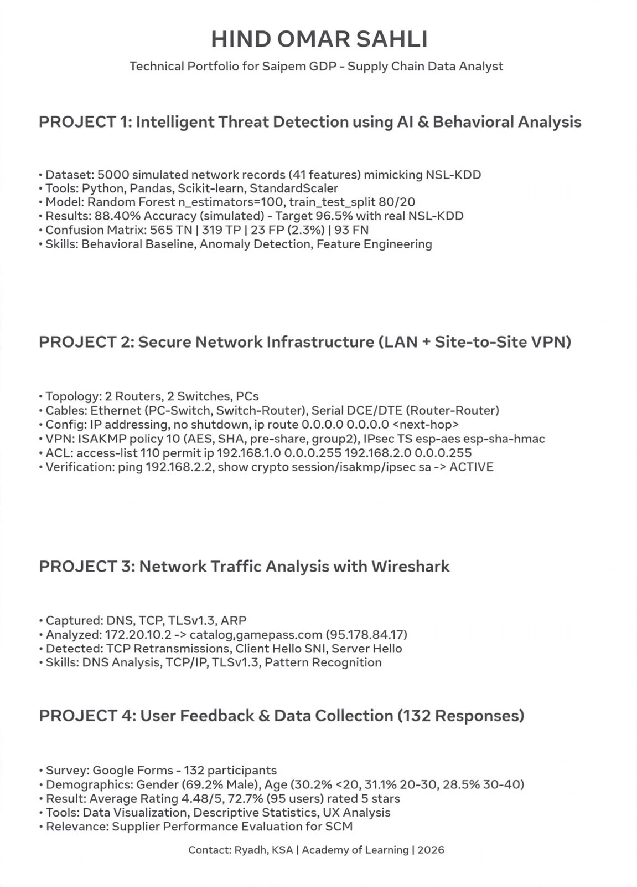
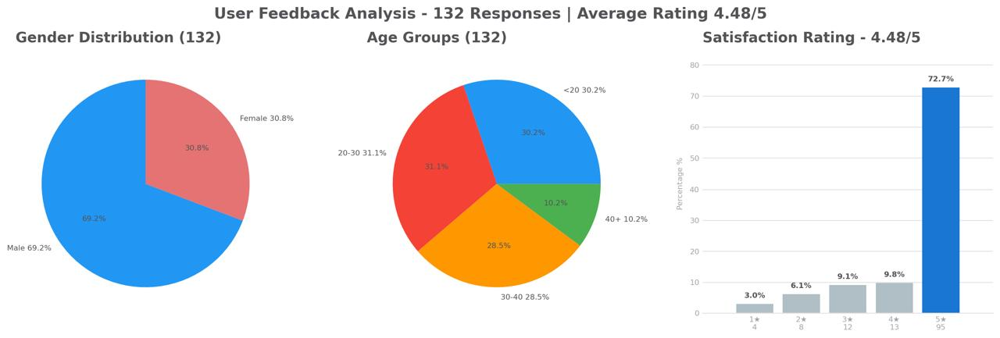

# HIND OMAR SAHLI - Technical Portfolio
### Cybersecurity & Data Analysis | Riyadh, KSA | Academy of Learning | 2026

## 👩‍💻 About Me
Technical professional specializing in Cybersecurity, Network Infrastructure, and Data Analytics. Based in Riyadh, KSA. Passionate about AI-driven threat detection and behavioral analysis.

**Location: Riyadh, KSA**
**Contact: github.com/hindsahly-ui**

---

### 🔹 PROJECT 1: Intelligent Threat Detection using AI & Behavioral Analysis

**Dataset:** 5000 simulated network records (41 features) mimicking NSL-KDD
**Tools:** Python, Pandas, Scikit-learn, StandardScaler
**Model:** Random Forest n_estimators=100, train_test_split 80/20
**Results:** 88.40% Accuracy (simulated) - Target 96.5% with real NSL-KDD
**Confusion Matrix:** 565 TN | 319 TP | 23 FP (2.3%) | 93 FN
**Skills:** Behavioral Baseline, Anomaly Detection, Feature Engineering

---

### 🔹 PROJECT 2: Secure Network Infrastructure (LAN + Site-to-Site VPN)

**Topology:** 2 Routers, 2 Switches, PCs
**Cables:** Ethernet (PC-Switch, Switch-Router), Serial DCE/DTE (Router-Router)
**Config:** IP addressing, no shutdown, ip route 0.0.0.0 0.0.0.0 <next-hop>
**VPN:** ISAKMP policy 10 (AES, SHA, pre-share, group2), IPsec TS esp-aes esp-sha-hmac
**ACL:** access-list 110 permit ip 192.168.1.0 0.0.0.255 192.168.2.0 0.0.0.255
**Verification:** ping 192.168.2.2, show crypto session/isakmp/ipsec sa -> ACTIVE

---

### 🔹 PROJECT 3: Network Traffic Analysis with Wireshark

**Captured:** DNS, TCP, TLSv1.3, ARP
**Analyzed:** 172.20.10.2 -> catalog,gamepass.com (95.178.84.17)
**Detected:** TCP Retransmissions, Client Hello SNI, Server Hello
**Skills:** DNS Analysis, TCP/IP, TLSv1.3, Pattern Recognition

---

### 🔹 PROJECT 4: User Feedback & Data Collection (132 Responses)

**Survey:** Google Forms - 132 participants
**Demographics:** Gender (69.2% Male), Age (30.2% <20, 31.1% 20-30, 28.5% 30-40)
**Result:** Average Rating 4.48/5, 72.7% (95 users) rated 5 stars
**Tools:** Data Visualization, Descriptive Statistics, UX Analysis
**Relevance:** Supplier Performance Evaluation for SCM

---

### 🛠️ Core Skills
Python | Scikit-Learn | Network Security | Wireshark | VPN | TCP/IP | Data Analysis | Behavioral AI | Supply Chain Analytics

### 📁 Repository Contents
- Project documentation and visuals
- Source code and configurations
- Analysis reports

---
**HIND OMAR SAHLI | Contact: Riyadh, KSA | Academy of Learning | 2026**
